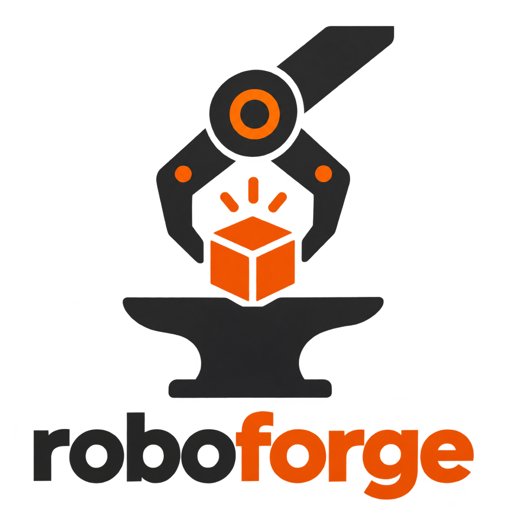
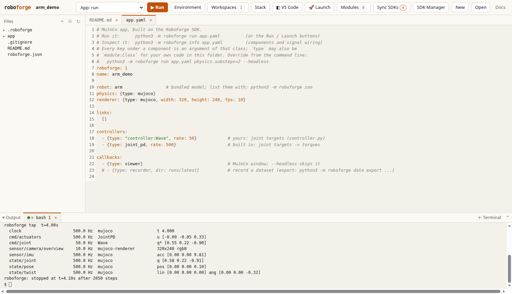
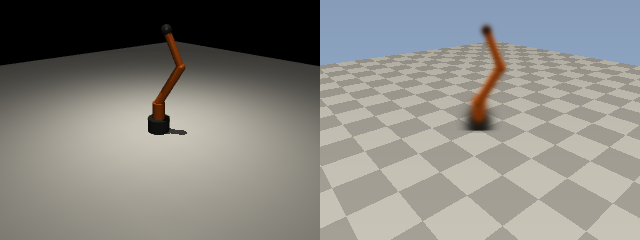

<p align="center">
  
</p>

<h3 align="center">An Android-Studio-style home for robotics: one IDE, one SDK,<br>any simulator, ROS 2 and MAVLink as interchangeable parts.</h3>

<p align="center">
  
  
  
  
  
  
  
</p>

<p align="center">
  <a href="#quick-start">Quick start</a> ·
  <a href="#philosophy">Philosophy</a> ·
  <a href="#how-it-compares">How it compares</a> ·
  <a href="#tutorials">Tutorials</a> ·
  <a href="#what-is-tested">What is tested</a> ·
  <a href="sdk/python/docs">Documentation</a>
</p>

---

RoboForge is two things that work together:

- **An IDE** (Rust, native window or browser) that installs every robotics SDK
  side by side without root, scaffolds projects, understands existing ROS
  workspaces, and runs and launches them, with terminals and an embedded VS Code.
- **A Python SDK** in which the simulator, the renderer, ROS 2 and MAVLink are
  interchangeable parts on one signal bus. You write the controller once; it
  runs against MuJoCo, behind ROS topics, as a MAVLink vehicle, under a real
  PX4 autopilot, or as a Gymnasium environment.

<p align="center">
  
</p>

## Quick start

**The IDE**

```bash
cargo build --release --features desktop   # native window (needs libwebkit2gtk-4.1-dev)
cargo build --release                      # or: browser mode, no system libraries needed
./target/release/roboforge                 # opens the IDE; --browser to use a browser tab
```

Then **New ▸ Build on the RoboForge SDK**, pick *MuJoCo + MAVLink*, press
**Set up SDK environment** when asked, and **▶ Run**. The SDK, its examples and
all the documentation ship inside the binary.

**The SDK, from Python**

```python
import roboforge as rf

app = rf.App(robot="arm",
             controllers=[rf.JointPD(rate=500, target=[0.5, 0.4, -0.8])],
             links=[rf.Ros2Link()])          # the same arm, now on ROS 2 topics
app.run(duration=10)
```

**…or from a file, with no code at all**

```yaml
# app.yaml
roboforge: 1
robot: quadrotor
links:
  - {type: mavlink, mode: vehicle}         # MAVLink clients can fly it, no autopilot needed
  - {type: ros2}                           # and ROS 2 sees /odom, /imu, /tf, /clock
controllers:
  - {type: multirotor, rate: 250}
```

```console
$ python3 -m roboforge run app.yaml --tap --check
```

`--tap` prints every signal's rate, source and value; `--check` tells you, in
plain words, why a robot is not doing what you expected.

**…or write the controller in C++**

```cpp
#include <roboforge/controller.hpp>

class Hold : public rf::Controller {
 public:
  explicit Hold(const rf::Params& p) : kp_(p.number("kp", 40.0)) {}
  rf::Action step(const rf::Obs& obs) override {
    rf::Vec u(obs.joints());
    for (int i = 0; i < obs.joints(); ++i) u[i] = -kp_ * obs.q(i) - 4.0 * obs.qd(i);
    return rf::Action::actuators(u);
  }
 private:
  double kp_;
};
RF_EXPORT_CONTROLLER(Hold)
```

```yaml
controllers:
  - {type: cpp, source: hold.cpp, rate: 500, kp: 60}    # compiled for you on first run
```

One header, no bindings, no build files: the SDK compiles, caches and loads
it, and C++ and Python controllers mix freely in one app.

## Philosophy

Robotics stacks are usually glued together: a bridge from this simulator to
ROS, another from that simulator to PX4, a third from ROS to MAVLink. With
*N* simulators and *M* transports that is *N × M* bridges, most of which do not
exist. RoboForge replaces the glue with one idea and a few rules.

**One bus instead of bridges.** Every part publishes and reads named, typed
signals (`state/pose`, `sensor/imu`, `cmd/setpoint`…) on one in-process bus. A
simulator is one adapter, a transport is one adapter, and any of them combine.
Adding ROS 2 to an app is one line.

| Rule | What it means in practice |
|---|---|
| **A library first, a framework second** | Every part works on its own; `app.step()` lets you own the loop; `physics.raw` hands you MuJoCo's own objects |
| **Nothing is privileged** | Simulator, renderer and middleware each sit behind a small interface. Your own solver, renderer or SLAM method plugs in the same way the built-ins do |
| **Physics and rendering are separate** | Any physics with any renderer: MuJoCo dynamics drawn by a Gaussian-splat renderer is one config line |
| **Explicit over magic** | Flat config files with no inheritance or interpolation; `roboforge info` prints exactly what will run; time is explicit and runs are bit-for-bit deterministic |
| **Your language** | Controllers in Python or C++, side by side in one app; C++ ROS 2 nodes and MAVLink clients connect through the links |
| **From a PID loop to a VLA** | A controller is `step(obs, t)`. Each runs at its own rate; slow models run asynchronously with action chunks and a fallback, so a 2 Hz policy never slows a 500 Hz loop |
| **Same code in simulation and on the robot** | Swapping `physics: mujoco` for `physics: none` plus a link is the whole move |
| **Errors you can act on** | Every mistake names what was found, what is allowed and what was probably meant. Bad input from ROS or MAVLink is dropped with a warning, never passed to a motor |
| **Honest about the edges** | What is tested, and what is not, is written down, below and in the docs |

## How it compares

RoboForge borrows from many good tools and tries to cover the gap between
them. The fair summary, including when to use something else:

| Tool | What it does very well | Where RoboForge differs | Use it instead when |
|---|---|---|---|
| **ROS 2 + ros2_control + simulator bridges** | The standard middleware and hardware abstraction, with a huge ecosystem | No packages, launch files or XML to start; one bus replaces a bridge per simulator; sim time is handled for you. ROS 2 is a *link*, not a requirement | You need the ROS ecosystem as the backbone. RoboForge then sits next to it as one more node |
| **PX4 SITL + Gazebo, Pegasus (Isaac)** | The real autopilot in the loop | MuJoCo has had no MAVLink path; here PX4 flies a MuJoCo vehicle in lockstep, and a MAVLink *vehicle* mode needs no PX4 at all | You need Gazebo's sensor plugins or PX4's own Gazebo worlds |
| **Isaac Lab, Genesis, ManiSkill** | Massively parallel GPU training | CPU-first, runs on a laptop, and the same app talks ROS 2 and MAVLink, so a trained policy deploys unchanged | You need thousands of parallel environments on a GPU |
| **RoboVerse / MetaSim** | One API over several simulators for learning benchmarks | Adds middleware, autopilots, a deployment path and an IDE | You are benchmarking learning across simulators |
| **Drake** | Rigorous systems framework, optimisation, verification | Much smaller learning curve; built around ROS and MAVLink rather than its own physics | You need Drake's analysis and optimisation tools |
| **LeRobot, robosuite** | Datasets and policies for manipulation | Any robot (multirotors, wheeled bases, URDFs), any transport; `rf.Policy` trains with Gymnasium tools and deploys as a controller | You want their pretrained policies and datasets (wrap them in `rf.Policy`) |
| **nerfstudio, Gaussian-splat SLAM repos** | State-of-the-art reconstruction | Live sensors with simulator ground truth; recordings export straight to nerfstudio and TUM; ATE and RPE built in | You only need offline reconstruction from real images |
| **Android Studio (the inspiration)** | SDK manager, templates, run configs, inspectors | The same shape for robotics: SDK Manager, stack picker, run and launch configurations, a Stack view, a signal tap | You build Android apps |

## What's in the box

<table>
<tr><th width="50%">IDE</th><th width="50%">SDK</th></tr>
<tr><td valign="top">

- **SDK Manager**: ROS 1 and six ROS 2 distros, PX4, MAVSDK, MoveIt, Nav2,
  Gazebo, MuJoCo, Isaac Sim/Lab, PyTorch, gsplat, SLAM systems; side by side
  under `~/.roboforge`, no root
- **New project**: presets, 15 mix-and-match modules, or the SDK **stack
  picker** (simulator × robot × autopilot × ROS 2 × Python or C++)
- **Import** any folder: ROS workspaces, launch files, scripts and tests
  are detected and turned into run and launch configurations
- **Terminals** (real PTYs), **launch configurations**, **embedded VS Code**,
  **Stack view**, HTML docs
- Native window (Tauri) or browser

</td><td valign="top">

- **Physics**: MuJoCo, `none` (real robot), or your own
- **Robots**: quadrotor, arm, wheeled base; any URDF or MJCF (motors and a
  ground are added; floating bases for humanoids)
- **Links**: ROS 2; MAVLink as vehicle, client, or **PX4-in-the-loop**
- **Control**: PID, joint, multirotor and diff-drive controllers; async
  policies with action chunks; `rf.Policy` for learned ones; **C++
  controllers** from one header
- **Rendering**: colour, depth, render passes, custom renderers
- **Data**: recorder, nerfstudio and TUM export, `rf.eval` (ATE, RPE)
- **Training**: any app as a Gymnasium env (stable-baselines3 tested)
- **Debugging**: `--tap`, `--check`, one-line errors

</td></tr>
</table>

### Any combination

| Combination | Status |
|---|---|
| MuJoCo + ROS 2 | ✅ arm and wheeled base on topics; commands from ROS |
| MuJoCo + MAVLink | ✅ the simulator is a MAVLink vehicle; missions fly over UDP |
| ROS 2 + MAVLink | ✅ bridge with no simulator |
| MuJoCo + MAVLink + ROS 2 | ✅ fly over MAVLink while ROS watches |
| MuJoCo + **real PX4 SITL** | ✅ PX4 passes preflight, takes off, hovers within 1 cm, lands; flies an OFFBOARD mission |
| Your own physics / renderer / policy / SLAM | ✅ one class each ([tutorials 14–17](#tutorials)) |
| A controller in C++ | ✅ bit-for-bit identical to the Python one it mirrors ([tutorial 18](#tutorials)) |

<p align="center">
  <br>
  <sub>The same moment drawn by MuJoCo (left) and by a custom Gaussian-splat renderer written in numpy (right): one config line apart.</sub>
</p>

## Tutorials

Eighteen small tutorials, CPU only, each runs in seconds to a minute. They
ship with the IDE in `~/.roboforge/sdk/python/examples/`.

| Track | Tutorials |
|---|---|
| **Basics** | 1 First app · 2 Arm on ROS 2 · 3 Wheeled base and `cmd_vel` · 4 Quadrotor over MAVLink · 5 All three · 6 ROS 2 ↔ MAVLink bridge |
| **Learning and data** | 7 From a PID loop to a slow policy · 8 Record and export for NeRF / splatting / SLAM · 11 Train with Gymnasium · 12 Render passes |
| **Real autopilot, real models** | 9 Real PX4 flying the MuJoCo vehicle · 10 Your own URDF |
| **Debugging** | 13 Find five mistakes in a broken app |
| **Build your own** | 14 Policy (numpy, PyTorch, stable-baselines3) · 15 Renderer · 16 Physics solver · 17 Sensors and SLAM · 18 A controller in C++ |

## Documentation

- **Full docs** (Read the Docs, Sphinx): `sdk/python/docs`: install,
  concepts, all tutorials, guides, troubleshooting by symptom, every error
  message explained, API reference. Build locally:
  ```bash
  cd sdk/python && pip install -r docs/requirements.txt && python -m sphinx -b html docs docs/_build/html
  ```
  `.readthedocs.yaml` is in place for publishing.
- **In the IDE**: the **Docs** button opens the IDE guide and the SDK guide.

## What is tested

| Area | How |
|---|---|
| SDK | 98 tests: every example and tutorial is run, C++ controllers are built (from source and with CMake) and checked against Python, the docs build with warnings as errors and the code they show is executed |
| Battle tests | 39 scenarios that try to break it: user mistakes, 10-minute runs, 300 apps opened and closed, hostile MAVLink and ROS peers, threads (`sdk/python/tests/battle`) |
| Real PX4 | v1.18 built from source, flown with pymavlink and with the SDK's own client (`tests/px4`) |
| IDE | 17 core tests; all 14 stack-picker combinations created and run through the IDE's API (`tests/api`); headless-browser UI checks (`tests/ui`) |

**Not tested yet:** a physical robot; QGroundControl and MAVSDK; ROS 2 other
than Jazzy; macOS and Windows; GPU training; the RoboStack/micromamba
environment installs of the SDK Manager (the recipes follow upstream
documentation but have not been run end to end); the generated module nodes
(MoveIt, Nav2, MAVSDK bridge) against their real stacks.

## Roadmap

- **Experiments**: wrappers for ORB-SLAM3, FAST-LIO, nerfstudio, gsplat,
  MonoGS; a splat renderer over trained scenes; LeRobot and VLA policies;
  Experiments panel and signal monitor in the IDE.
- **More simulators**: Gazebo and Isaac backends, a Simulator Manager,
  ArduPilot, lidar, multi-robot, learned world models.

The plan is in [`docs/plans/sdk-framework-plan.md`](docs/plans/sdk-framework-plan.md).

---

## Reference

<details>
<summary><b>How SDK isolation works</b></summary>

| Thing | Where | Shared? |
|---|---|---|
| micromamba (one static binary) | `~/.roboforge/tools/` | yes |
| Source SDKs (PX4, XRCE agent, SLAM repos, Isaac Lab) | `~/.roboforge/sdks/<id>/` | yes, versions side by side |
| Environments (ROS + Python packages) | `~/.roboforge/envs/<name>/` | per component set |
| Package cache | `~/.roboforge/mamba/` | yes |

- ROS 1 Noetic and ROS 2 Humble/Jazzy/Kilted/Lyrical/Rolling come from
  RoboStack conda channels, so no distro is tied to an Ubuntu release and any
  number can be installed at once. A system ROS in `/opt/ros` is used when
  present and the environment is not synced.
- An environment's name is derived from its component set
  (`mujoco__ros2-jazzy`). Two projects with the same selection share it; a
  different selection can never modify it.
- Isaac Sim always gets its own environment (`own-isaac`) because it pins its
  dependency set. It talks to the ROS environment over DDS.
- A project's `roboforge.json` lists its components and run configurations.
  `.roboforge/activate.sh` is generated from it; run configurations execute
  inside that activation.
- Installs are recorded unit by unit in `~/.roboforge/state.json`, so a failed
  or cancelled install resumes.

Host requirements: Linux, `bash`, `git`, `curl`, `tar`, `bzip2`. Everything
else (ROS, compilers, cmake, Python) comes from the SDK environments.
</details>

<details>
<summary><b>Workspaces</b></summary>

A project is a set of folders, like roots in a VS Code multi-root workspace,
listed under `workspaces` in `roboforge.json`:

| kind | default folder | holds |
|---|---|---|
| `ros2` / `ros1` | `ros2_ws/` / `catkin_ws/` | colcon / catkin workspace; the project's package in `src/` |
| `mav` | `mav_ws/` | standalone MAVSDK / PX4 applications, no ROS |
| `sim` | `sim/` | simulator models, worlds, scripts outside ROS |
| `ml` | `ml/` | training and research code |
| `isaac` | `isaac/` | Isaac Sim apps (dedicated Isaac environment) |
| `app` | `app/` | an SDK app (`app.yaml`), or an imported folder |

Reusing an existing ROS workspace: pick "Reuse an existing ROS workspace" in
the wizard (`--workspace ~/ros2_ws` on the CLI). Or set one up in place
("Set up this workspace" in Open, `roboforge init --ros humble`): only
`roboforge.json` and `.roboforge/` are added. **Import** creates a project in
`~/roboforge-projects/<name>` that points at any folder without changing it.

`.roboforge/activate.sh` activates the SDK environment, exports SDK paths
(`PX4_DIR`, ...) and `RF_WS_<KIND>` per workspace, overlays every ROS
workspace in order, sets `GZ_SIM_RESOURCE_PATH`, caps build parallelism, then
exports the project's `env` map (`ROS_DOMAIN_ID`, `ROS_LOCALHOST_ONLY`, ...).
</details>

<details>
<summary><b>Modules: mix and match</b></summary>

A project is a ROS choice plus any set of modules. A module is one paradigm
(MoveIt, Nav2, slam_toolbox, MAVSDK, PX4 offboard, MuJoCo, ...) and declares
the SDK components it needs, the files it contributes, ROS package
dependencies, run configurations (including ones that only appear next to
another module), and optional entries in the generated `bringup.launch.py`.

Built in (15): `moveit`, `nav2`, `slam-toolbox`, `gs-slam`, `mavsdk`,
`px4-sitl`, `px4-offboard`, `gazebo`, `mujoco`, `isaac`, `isaac-lab`, `torch`,
`pytorch3d`, `gsplat`, `mission`.

Modules can be changed after creation (the Modules button, or
`roboforge add` / `roboforge remove`): new files are created, existing files
are never overwritten, managed files (`package.xml`, `setup.py`,
`bringup.launch.py`) are regenerated, and your own run configurations are kept.

**Your own module:** create `~/.roboforge/modules/<id>/module.json` and put
templates in `files/`. No rebuild.

```json
{
  "id": "lidar-driver",
  "name": "Lidar driver",
  "category": "drivers",
  "summary": "Publishes /scan from the device.",
  "ros": "ros2",
  "components": ["open3d", "group:torch=torch-cpu"],
  "requires": ["nav2"],
  "depends": ["sensor_msgs"],
  "files": [{"src": "driver.py", "dest": "@PKGDIR@/@PKG@/lidar_driver.py"}],
  "run": [{"name": "Lidar: driver", "cmd": "ros2 run @PKG@ lidar_driver", "when": ["ros2"]}],
  "launch": [{"name": "lidar", "node": {"package": "@PKG@", "executable": "lidar_driver"}}]
}
```

Placeholders: `@PKG@`, `@NAME@`, `@PKGDIR@`, `@ASSETS@`, `@ROS_DISTRO@`,
`@PX4_BRANCH@`. `when` tokens: `ros2`, `ros1`, `noros`, `mod:<id>`,
`!mod:<id>`. Built-in modules use the same format; see
`crates/roboforge-core/modules/`.
</details>

<details>
<summary><b>Catalog and presets</b></summary>

27 SDK components are built in (`crates/roboforge-core/src/catalog.json`):
six ROS distros, PX4 1.15/1.16, Micro XRCE-DDS agent, MAVSDK, pymavlink,
MoveIt, Nav2, Gazebo, MuJoCo, Isaac Sim, Isaac Lab, PyTorch (CUDA/CPU),
PyTorch3D, gsplat, Open3D, slam_toolbox, MonoGS, SplaTAM, ORB-SLAM3 and the
RoboForge SDK. To change a version or add an SDK, copy that file to
`~/.roboforge/catalog.json` and edit it; no rebuild needed.

Presets: `ros2`, `ros1`, `px4`, `mujoco`, `ros2-px4`, `ros2-mujoco`,
`manipulation`, `navigation`, `mixed`, `full`, `isaac`, `vision3d`, `gs-slam`.
A preset only pre-ticks a ROS choice and modules; any other mix works.
</details>

<details>
<summary><b>Command line</b></summary>

```bash
roboforge                                 # the IDE (native window in desktop builds)
roboforge --browser --port 7878           # the IDE in a browser tab
roboforge modules                         # what can be mixed in
roboforge new navigation ~/ws/bot --ros humble --modules moveit,mavsdk
roboforge add mission mujoco --dir ~/ws/bot
roboforge init ~/ros2_ws --ros jazzy      # set up an existing workspace in place
roboforge sdk plan ros2-humble gazebo     # print install commands, change nothing
roboforge sync ~/ws/bot                   # install what the project pins
roboforge run "Build workspace (colcon)" ~/ws/bot

python3 -m roboforge run app.yaml [--tap] [--check] [--headless] [path=value ...]
python3 -m roboforge info app.yaml        # parts and signal wiring
python3 -m roboforge doctor               # what works in this environment
python3 -m roboforge data export runs/x --format nerfstudio --out ns/
python3 -m roboforge cpp new my_controller  # a C++ controller to start from; cpp build / cpp include
```
</details>

<details>
<summary><b>Platform and security</b></summary>

Linux. The backend uses bash, Unix process groups and signals, and the SDK
recipes target Linux, so on Windows build and run it inside WSL2 (GUI
simulators work via WSLg). macOS is untested; the build is refused on Windows
with a message saying so.

The backend binds to 127.0.0.1 only, rejects requests whose Host header is
not loopback, and requires a per-session random token on every API call. It
runs commands as you, so do not expose the port.
</details>

<details>
<summary><b>Repository layout</b></summary>

```
crates/roboforge-core/           catalog, resolver, install planner, modules, generator, scanner, SDK scaffolding (+ tests)
crates/roboforge-core/modules/   built-in modules: module.json + files/ each
crates/roboforge/                CLI, jobs, terminals, HTTP API, Tauri window, embedded UI (ui/index.html)
sdk/python/roboforge/            the Python SDK
sdk/python/examples/             the tutorials' apps and scripts
sdk/python/docs/                 the Read the Docs site
sdk/python/tests/                SDK tests, battle tests (tests/battle)
docs/                            IDE and SDK guides shown in the app, plans, README images
tests/api, tests/ui, tests/px4   IDE API checks, headless-browser driver, real-PX4 flights
```
</details>
