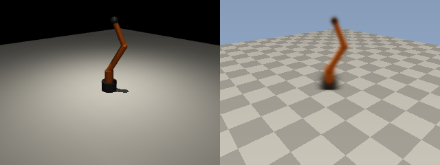

15. Write your own renderer
===========================

**You will:** replace MuJoCo's renderer with a Gaussian-splat renderer
written in numpy, and see that everything downstream takes its frames
unchanged. **Time:** 10 minutes. **Needs:** MuJoCo (for the physics only:
the renderer needs no OpenGL).

What it takes
-------------

One method, ``render(camera) -> rf.Image``. The ``rf.Renderer`` base class
publishes ``sensor/camera/<name>`` at ``fps``, picks the robot's cameras,
runs render passes (``finish``), and ``app.physics.camera(name)`` says where
the camera is. The whole interface of ``splat.py``:

.. code-block:: python

   class SplatRenderer(rf.Renderer):
       def setup(self, app):          # once: turn the model's shapes into splats
           super().setup(app)
           ...
       def render(self, camera):      # every frame
           pose, fovy = self.physics.camera(camera)
           ...                        # project, sort, blend
           return self.finish(rf.Image(data=pixels, camera=camera, fovy=fovy, pose=pose, t=t))

How it draws
------------

Each shape in the model becomes a few 3D Gaussians: one for a sphere, a row
along a capsule, a grid in a box. Each frame they move with their bodies, are
projected through the camera, sorted far to near and alpha-blended, the way
3D Gaussian-splatting renderers draw a scene. The floor is ray-traced.

.. literalinclude:: ../../examples/custom_renderer/splat.py
   :language: python
   :pyobject: SplatRenderer.render
   :lines: 1-12

Use it
------

.. literalinclude:: ../../examples/custom_renderer/app.yaml
   :language: yaml
   :lines: 4-

One line differs from a MuJoCo-rendered app. The recorder records its frames
and ``roboforge data export`` exports them for nerfstudio like any others.

.. code-block:: console

   $ cd custom_renderer
   $ python3 -m roboforge run app.yaml --headless --duration 2 --tap
     sensor/camera/overview     10.0 Hz  splat     320x240 rgb8
   $ python3 compare.py
   splat renderer:  12.0 ms per 320x240 frame, pure numpy
   MuJoCo renderer:   0.5 ms per frame, OpenGL
   same camera pose in both: True
   arm in the MuJoCo frame: x 152-184, top at y 34
   arm in the splats frame: x 153-184, top at y 36

``frames/compare.png``, MuJoCo on the left, splats on the right:

From here to neural rendering
-----------------------------

Two swaps turn this toy into the real thing, and neither touches the rest of
the app:

- **The splats:** load them from a trained 3D Gaussian-splatting scene (a
  ``.ply`` from nerfstudio's ``splatfacto``) instead of making them from the
  model's shapes.
- **The blending:** hand the projected splats to a GPU rasteriser such as
  ``gsplat`` instead of the numpy loop.

Fly a robot in MuJoCo, record (:doc:`record_export`), train a splat scene on
the export, and render that scene back as the robot's camera: the loop closes
through this one interface.

If something goes wrong
-----------------------

``the splat renderer reads shapes from a MuJoCo model``
   This example needs the model's geometry; a renderer over a trained scene
   would not.

Frames are slow
   12 ms per frame in numpy. Lower ``fps``, or render on demand with
   ``renderer.render(camera)`` only when a controller needs a frame.
